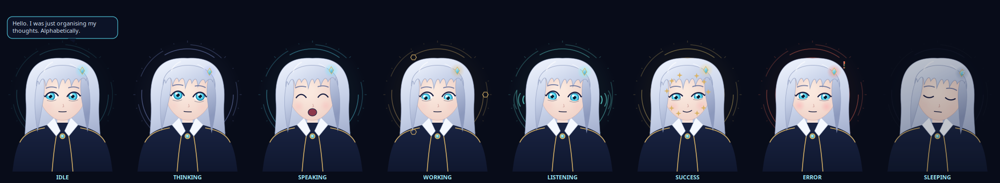

# Wednesday

A local-first AI companion that lives on your Linux desktop: an animated anime-style avatar
floating above your windows, with a private language model running on your own GPU.
She talks back, uses tools when you allow it, remembers what you ask her to remember, and has opinions about your sleep schedule.



- **Local brain.** Qwen3.5-2B on llama.cpp (Vulkan) on the RTX 3050. Measured: **about 1.4 s median for a complete short reply**, 40–60 tok/s, 1.5 GB VRAM. No cloud model, no telemetry, no fallback.
- **A real desktop presence.** A Wayland layer-shell overlay on Hyprland. She never steals focus, and clicks pass through everywhere except her silhouette.
- **Personality.** Deadpan humour, eleven moods driving real facial expressions, and canned one-liners for system moments (those cost zero GPU).
- **Tools behind a permission wall.** Files, shell, git, web research, memory, task plans. Read-only actions run immediately, writes ask you first, and destructive or credential-touching ones are refused.
- **Voice (optional).** Push-to-talk speech recognition (Whisper) and speech output (Piper) on the CPU, with lip-sync driven by the actual audio.

## Start (one command)

```bash
cd ~/Wednesday && ./wednesday
```

The first run sets everything up and asks before each download. After that, from anywhere:

```bash
wednesday
```

That starts the backend and the avatar in about 1 second. The model loads and warms up in the background (about 3 s).

**Using her:**
- **Click her** to open or close the chat panel.
- **Drag** to move her, and **Ctrl+scroll** to resize. Position and size are remembered.
- **Right-click** for push-to-talk, speak-aloud, ghost mode (fully click-through), free the GPU, emergency stop, hide, and quit.
- **In the panel:** `Esc` stops a reply, or closes the panel when she's idle. The 🎙 button is push-to-talk: click to start, click again to send.

## Everyday commands

| Command | What it does |
|---|---|
| `wednesday` | start everything (safe to run twice) |
| `wednesday stop` | stop everything; the GPU is freed |
| `wednesday restart` | stop + start |
| `wednesday chat` | full chat in the terminal, with approvals inline |
| `wednesday ask "…"` | one-shot question |
| `wednesday status` | state, mood, model, live CPU/RAM/VRAM/temperatures |
| `wednesday doctor` | full health check, plus which protections are active |
| `wednesday panel` / `toggle` / `ghost` | open chat / hide-show avatar / click-through mode |
| `wednesday talk` | push-to-talk toggle |
| `wednesday halt` | **emergency stop**: cancel generation, kill tool processes, stop speech |
| `wednesday unload` | free the GPU now (reloads automatically on the next message) |
| `wednesday logs -f` | follow the logs |
| `./wednesday test` | run the test suite |
| `./wednesday setup` | (re)install; idempotent, verifies checksums |
| `./wednesday uninstall` | remove (asks before deleting models or memories) |

## Hyprland keybinds and autostart (optional)

Nothing in your Hyprland config is touched unless you run this:

```bash
./scripts/hyprland.sh install
```

It checks your live binds for conflicts first and backs up `hyprland.conf`. It then adds one `source =` line pointing at its own file:
- **SUPER+ALT+W:** chat
- **SUPER+ALT+H:** hide/show
- **SUPER+ALT+T:** talk
- **SUPER+ALT+X:** emergency stop
- autostart on login

`./scripts/hyprland.sh remove` undoes it, and `show` prints the snippet. No window rules are needed: the avatar is a layer-shell surface.

## Configuration

Defaults live in `config/default.yaml`. Put **only the keys you want to change** into `~/.config/wednesday/config.yaml`. They are deep-merged, and setup never overwrites that file.

```yaml
# ~/.config/wednesday/config.yaml examples
assistant: {humor: 0.4}                  # 0 = professional … 1 = maximum deadpan
model: {active: qwen35-2b-q8, idle_unload_minutes: 10, thinking: fast}
web: {provider: brave}                   # needs BRAVE_API_KEY, see .env.example
avatar: {fps_idle: 4, sleep_after_minutes: 5}
voice: {speak_replies: true}
```

- **Switching models** is one key (`model.active`). Profiles carry the file, checksum, and sampling settings. Add your own GGUF as a new profile and run `./wednesday setup --model <profile>`.
- **Permissions:** copy `config/permissions.yaml` to `~/.config/wednesday/permissions.yaml` and add your project folders to `write_roots`, for example `~/ros2_ws`. Until then she can only write inside `~/Wednesday/workspace`.
- **Thinking modes** (panel dropdown or `/think` in `wednesday chat`):
  - `auto`: reasons only when the question looks like it needs it.
  - `fast`: never reasons; quickest.
  - `deep`: always reasons, capped at 512 thinking tokens.

## What needs your approval, and what's refused

| Tier | Examples |
|---|---|
| Runs immediately | read/list/search files in your home, `ls`, `cat`, `grep`, `git status/log/diff`, `nvidia-smi`, system status, web search (when online) |
| **Asks you** | writing files (inside `write_roots` only), `git push/commit/reset`, `pip/npm install`, any program not on the read-only list, running scripts, opening URLs |
| **Refused** | `sudo`/`su`, `dd`/`mkfs`, `shutdown`, deleting outside `write_roots`, anything touching `~/.ssh`, `.env`, keys, browser profiles, or Wednesday's own config; shell chaining (`;` `&&` `>` `$(...)`) |

Details are in [docs/SECURITY.md](docs/SECURITY.md).

## Requirements

- Ubuntu 24.04+ (tested on 26.04.1)
- Hyprland or another wlroots compositor (falls back to a normal window elsewhere)
- Python 3.11+ with `python3-venv`, `python3-gi`, `gir1.2-gtklayershell-0.1`, `python3-gi-cairo`, PipeWire tools
- An NVIDIA GPU with a Vulkan driver (CPU fallback works but is slow)
- About 1.6 GB disk (2.3 GB with the Q8 model)

Setup never runs `sudo`. If a system package is missing, it prints the `apt` command for you to run.

## Docs

- [docs/REPORT.md](docs/REPORT.md): what was built and tested, measured numbers, and known limitations. **Start here.**
- [docs/ARCHITECTURE.md](docs/ARCHITECTURE.md): components, data flow, design decisions
- [docs/SECURITY.md](docs/SECURITY.md): threat model and permission system
- [docs/PROTOCOL.md](docs/PROTOCOL.md): local HTTP/WebSocket API and the avatar event protocol
- [CHANGELOG.md](CHANGELOG.md): decisions and fixes, in order

## License

MIT for this code. Third-party pieces are downloaded at setup, not bundled: llama.cpp (MIT), Qwen3.5 weights (Apache-2.0), Piper (GPL-3.0, separate package), cori voice (public domain), Whisper base.en (MIT). The avatar is original procedural vector art drawn in code, so no third-party artwork is involved.
